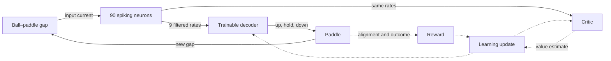
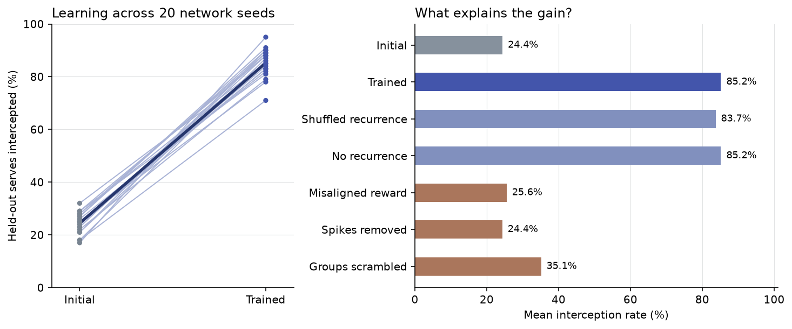

# Spiking Pong

How does a spike pattern come to mean “move the paddle down”? This simulation gives a controller the activity of 90 Izhikevich neurons and lets it learn from the consequences of each move. The neurons’ connections stay fixed. A trainable decoder learns to turn their firing rates into paddle movements, and a critic learns to predict future reward.

Each serve ends at the first paddle encounter. Across 20 held-out network seeds, training raised the mean interception rate from **24.4% to 85.2%**. Explore the animated model and the hardware project that motivated it on the [University of Minnesota Neuron Interface Project page](https://iamnikhiliyer.com/projects/closed-loop-neural-interfaces-with-ai/).



## Follow one decision

Within a neuron, $v$ tracks voltage, $u$ tracks recovery, and $I$ combines sensory, recurrent, and background current. When $v$ reaches 30 mV, the cell spikes, resets to $c$, and adds $d$ to its recovery variable. [Izhikevich, 2003](https://izhikevich.org/publications/spikes.htm)

$$
\frac{dv}{dt}=0.04v^2+5v+140-u+I, \qquad
\frac{du}{dt}=a(bv-u)
$$

Nine groups respond to different vertical gaps between the ball and the paddle. Each group contains eight excitatory and two inhibitory neurons. Every 50 ms the decoder takes a vector $f$ containing nine filtered excitatory firing rates and a constant bias. It scores three actions with $W$ and samples a movement from their probabilities.

$$
P(a\mid f)=\frac{e^{(Wf)_a}}{\sum_b e^{(Wf)_b}}
$$

At the start, $W$ is zero and all three movements are equally likely. During training, a hit earns +1, a miss earns −1, and changes in alignment provide feedback between encounters. The critic compares the reward and its next value estimate with its previous prediction. That difference updates the decoder’s weights for recent spike patterns and actions.

## Five notebooks

Each notebook includes its plots and runs independently from a fresh Python kernel. They share [one simulation file](notebooks/model.py). To read them in a browser, [open the rendered notebooks](https://nbviewer.org/github/iamnikhiliyer/spiking-pong/tree/main/notebooks/).

| Notebook | Experiment |
| --- | --- |
| [1 · One neuron](notebooks/01-one-neuron.ipynb) | Apply the same current pulse to two cell types and compare their spikes and recovery. |
| [2 · Encoding the court](notebooks/02-encoding-the-court.ipynb) | Move the ball from above the paddle to below it and follow the response through all 90 cells. |
| [3 · Learning a movement](notebooks/03-learning-a-movement.ipynb) | Hold the spike pattern fixed and watch one reward change the probability of moving down. |
| [4 · Train and play](notebooks/04-train-and-play.ipynb) | Train the website’s seed from scratch, inspect the learned weights, and follow its first held-out serve. |
| [5 · Test the claim](notebooks/05-test-the-claim.ipynb) | Analyze all 20 reserved seeds and optionally regenerate the benchmark from scratch. |

## What explains the gain?



Each thin line represents one network tested on the same 100 held-out serves before and after 320 training serves. The mean gain was **60.8 percentage points** (paired-seed 95% bootstrap interval **58.15–63.75**). The thick line connects the two means.

Suppressing spike inputs at evaluation brought the trained decoder back to **24.35%**. A separately trained decoder with recurrent transmission disabled still reached **85.2%**. The position-tuned groups already provided enough information for this task. These scores measure simulated interceptions. The portfolio’s pruning animation is an illustration on a copy of the readout. Evaluation uses the full learned weights.

## Run locally

From a terminal with Python 3.12, create an environment and open JupyterLab. The pinned NumPy version matches the benchmark runs.

```sh
git clone https://github.com/iamnikhiliyer/spiking-pong.git
cd spiking-pong
python3.12 -m venv .venv
source .venv/bin/activate
python -m pip install numpy==2.5.5 matplotlib==3.11.2 jupyterlab ipykernel
python -m jupyterlab notebooks
```

Open any notebook and select **Run All Cells**. Notebook 4 trains one seed. Notebook 5 includes the archived per-seed hit counts and an optional rerun of all four training conditions. All experiments run on CPU.

Released under the [MIT license](LICENSE).
